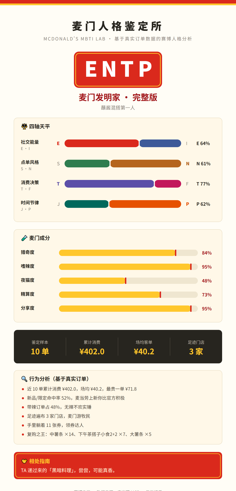

# 🧬 麦门人格鉴定所（MCD MBTI Lab）

> 麦当劳版 MBTI——不是答题测出来的，是**用你的真实订单算出来的**。

拉取你的麦当劳历史订单，从点单行为里解析出你的「麦门 MBTI」人格：
猎奇还是守旧、精算还是豪掷、晨型还是夜猫、独食还是分享——四轴评分 + 16 型人格 + 一张可晒的鉴定卡。



## ✨ 特色

- **真实数据驱动**：四轴评分全部来自 `order-list` 真实订单（新品命中率 / 辣度占比 / 时段分布 / 客单价结构 / 持券数量），不是随机抽签
- **16 型麦门人格**：从「麦门会计师」到「麦门发明家」，每型都有名称、 tagline、点单画像和相处指南
- **麦门成分分析**：猎奇度 / 嗜辣度 / 夜猫度 / 精算度 / 分享度，五维成分条
- **可分享鉴定卡**：麦当劳红黄配色的 SVG 人格卡，晒群晒朋友圈即用
- **诚实降级**：订单不足 3 单时输出「尝鲜体验版」并明说样本量，绝不编造人格
- **零依赖**：纯 Python 标准库，无需任何第三方包

## 🚀 快速开始

### 前置：申请麦当劳 MCP Token

1. 打开 [麦当劳 MCP 开放平台](https://open.mcd.cn/mcp)，右上角【登录】（手机号验证）
2. 点右上角【控制台】→【激活】，阅读并同意服务协议
3. 一键复制 MCP Token

### 鉴定

```bash
# 零门槛体验（内置模拟订单，无需 Token）
python scripts/run.py --mock

# 正式鉴定（Token 走环境变量，杜绝泄露）
export MCD_MCP_TOKEN="你的Token"
python scripts/run.py

# 只要文本报告
python scripts/run.py --text
```

输出：

- `output/persona.svg` —— 人格鉴定卡（可直接分享）
- `output/persona.json` —— 结构化鉴定数据

### 在 WorkBuddy 中配置 MCP

复制 `mcp-config.example.json` 内容到 WorkBuddy 的 MCP 配置（`~/.workbuddy/mcp.json`），
将 `${MCD_MCP_TOKEN}` 替换为你的 Token；也可以直接让 AI 助手调用本 Skill（见 [SKILL.md](SKILL.md)）。

## 🧭 四轴评分口径

| 轴 | 两 极 | 评分依据（全部来自真实订单） |
| --- | --- | --- |
| 社交能量 | **E**·麦门社交官 ↔ **I**·孤独美食家 | 大份量多件套订单占比、场均商品数 |
| 点单风格 | **S**·经典守卫者 ↔ **N**·猎奇尝鲜家 | 新品/限定命中率（非经典长青款占比） |
| 消费决策 | **T**·精算指挥官 ↔ **F**·氛围鉴赏家 | 低客单订单占比、持有优惠券数量 |
| 时间节律 | **J**·规律干饭人 ↔ **P**·随机浪人 | 下单时段集中度、深夜订单占比 |

16 型人格示例：麦门会计师（ISTJ）、麦门发明家（ENTP）、麦门群主（ESFJ）、
麦门诗人（INFP）、麦门军师（INTJ）……每型附点单画像与「相处指南」（拼单建议）。

## 🏗️ 工作原理

```
麦当劳 MCP (mcp.mcd.cn)
   │  Streamable HTTP + Bearer Token
   ▼
scripts/mcd_client.py     纯标准库 MCP 客户端（initialize → tools/call）
   │  4 个 Tool 的原始返回（Markdown），单个失败自动降级
   ▼
scripts/persona.py        人格引擎：订单聚合 → 四轴评分 → 16 型匹配
   │
   ▼
scripts/render_card.py    SVG 渲染器：测评卡版式
   │
   ▼
output/persona.svg        可分享的人格鉴定卡
```

- `scripts/orders` 逻辑内置于 `persona.py`：餐品计数、经典/新品判定、辣度、时段分桶、门店去重
- `scripts/run.py` —— 命令行入口（`--mock` / `--text`）

## 🔄 每周人格刷新

仓库内置 GitHub Action（`.github/workflows/weekly-persona.yml`）：每周一自动重新鉴定一次，
把新卡片归档到 `gallery/`——人格会随订单积累而演化，访客每次来都有新卡片可看。
配置一个 repo secret `MCD_MCP_TOKEN` 即可启用（不配则自动用演示模式兜底）。

## 📡 MCP 工具清单

| Tool | 用途 |
| --- | --- |
| `order-list` | 历史订单（人格评分核心数据源） |
| `query-my-coupons` | 我的优惠券（精算度信号） |
| `query-my-account` | 积分账户 |
| `list-nutrition-foods` | 餐品营养表（餐品池参考） |

详见 [MCP_INTEGRATION.md](MCP_INTEGRATION.md)。

## ⚠️ 免责声明

人格命名与描述为娱乐化演绎；四轴评分虽基于真实订单，但人格类型学并非科学诊断。
赛博玄学，数据来源：麦当劳 MCP，仅供娱乐。

## 📄 License

MIT
